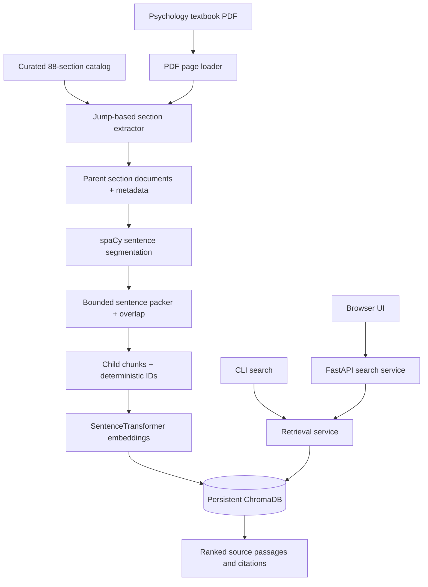
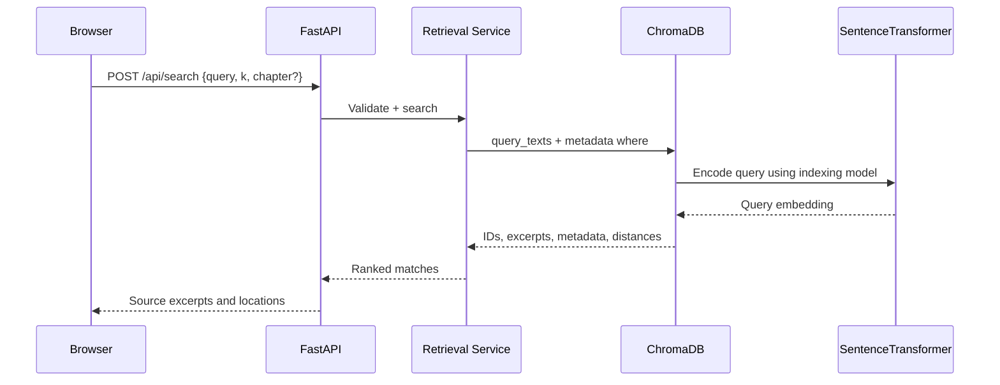
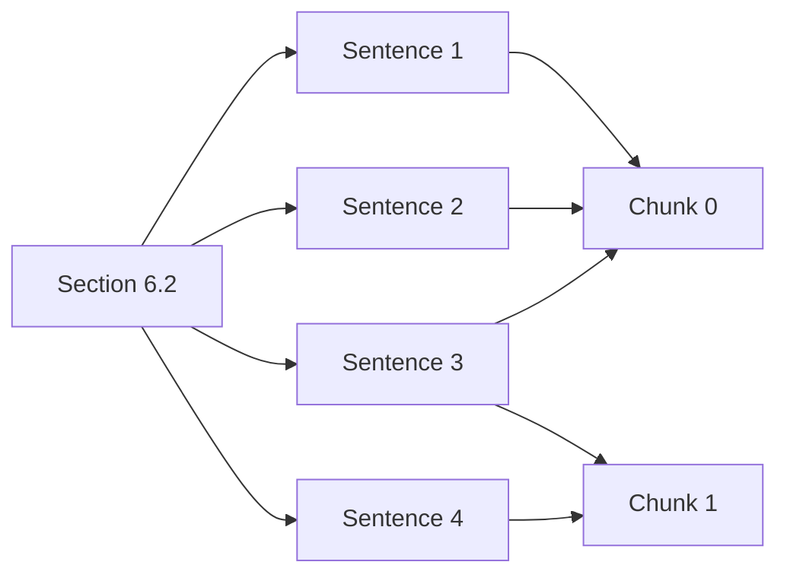

# Psychology Textbook Semantic Search

**Section-aware PDF ingestion, hierarchical chunking, persistent vector indexing, and web-based semantic retrieval.**

A deployable retrieval system built from an original textbook preprocessing notebook. It converts manually identified psychology textbook sections into metadata-rich, sentence-aware passages and indexes them using ChromaDB with Sentence Transformers. A FastAPI service and responsive browser interface let users search the indexed material and inspect the supporting excerpts with textbook references.

> **Implementation scope:** This is a **retrieval system**, not a generative chatbot. It returns matching source passages, distances, chapter identifiers, section headings, and page ranges. No LLM answer generation is claimed or included. The source textbook PDF is not distributed with this repository; obtain a copy you are authorized to use and confirm that it matches the section map.

## Contents

1. [Problem and engineering motivation](#1-problem-and-engineering-motivation)
2. [System architecture](#2-system-architecture)
3. [Technical deep dive](#3-technical-deep-dive)
4. [Engineering decisions and trade-offs](#4-engineering-decisions-and-trade-offs)
5. [Failure handling, integrity, and security](#5-failure-handling-integrity-and-security)
6. [Testing and verification](#6-testing-and-verification)
7. [Technology stack](#7-technology-stack)
8. [Local installation and usage](#8-local-installation-and-usage)
9. [HTTP API](#9-http-api)
10. [Docker deployment](#10-docker-deployment)
11. [Project structure](#11-project-structure)
12. [Known limitations and next steps](#12-known-limitations-and-next-steps)
13. [Notebook provenance](#13-notebook-provenance)

---

## 1. Problem and engineering motivation

Generic PDF chunking often divides content by character count or token limit without considering the document's logical organization. In a structured textbook, this can separate a definition from its section, pull introductory material into a later topic, or merge two semantically unrelated chapters.

The source notebook solves that problem in two stages. First it uses **explicit textbook page locations and heading text** to reconstruct logical sections. Then it applies **sentence-level packing with overlap** separately within each section. It embeds the resulting passages and retrieves them with cosine-distance semantic search.

This repository converts that working experimental flow into an installable, testable application without changing its core retrieval objective.

### Primary engineering requirements

- Preserve the source notebook's **88 manually curated sections in 16 chapters** and the explicit start/end page mapping.
- Extract actual section bodies, skipping unrelated textbook regions rather than treating every page as retrieval content.
- Keep **one section as the parent boundary**: no child chunk may contain text from two sections.
- Use **spaCy's English sentencizer**, **1,000-character default chunk limit**, and **two-sentence overlap**.
- Persist searchable chunks and associated metadata in **ChromaDB** using **`all-MiniLM-L6-v2`**.
- Allow repeated indexing without duplicate chunk records; expose retrieval through a CLI, a read-only HTTP API, and a minimal web interface.
- Make invalid catalog mappings and extraction failures observable rather than silently presenting an incomplete index as complete.

### What the application is designed to answer

Instead of producing a paraphrased answer, a query such as **“What is classical conditioning?”** returns the most semantically similar passages, with their section title and page information. The retrieved passage remains source text so the user can inspect the textbook evidence directly.

---

## 2. System architecture



### Ingestion and querying are deliberately separate

**Indexing is an explicit offline operation.** The CLI reads the source PDF, builds the section and child documents, and upserts them into ChromaDB. The server is not authorized to accept or ingest arbitrary uploaded documents. This separation avoids a heavy PDF-processing operation on every user query and prevents unknown visitors from replacing an index over HTTP.

**Querying is a read-only online operation.** FastAPI validates query parameters, asks the retrieval service for matching passages, and returns a structured response. The interface consumes that JSON to render excerpt cards and source metadata. ChromaDB persists on local disk, so indexing and serving need access to the same storage directory.

### End-to-end request flow



---

## 3. Technical deep dive

### 3.1 Textbook section catalog

The source notebook manually enumerates the beginning of each numbered textbook section, for example `1.1`, `6.2`, and `15.10`. Some last-in-chapter entries are ranges such as `"38-41"` because the following numbered section begins in a different chapter after supplemental materials.

The catalog is preserved verbatim as section IDs, headings, and boundary values in [`config/psychology_sections.json`](config/psychology_sections.json). An identical runtime copy is packaged in [`src/psych_search/data/`](src/psych_search/data/) so the installed Python package does not require a Git checkout.

Example (from the original mapping):

```json
{"section_id": "1.1", "heading": "1.1 What Is Psychology?", "pages": 20}
{"section_id": "1.4", "heading": "1.4 Careers in Psychology", "pages": "38-41"}
```

The catalog loader normalizes single start pages and explicit ranges into a typed `Section` structure, sorts section numbers **numerically** (`15.2` before `15.10`), rejects duplicate IDs and overlapping hard ranges, and ensures that each requested section has a bounded extraction endpoint.

**Why not discover sections automatically?** The notebook is explicitly anchored to one known edition. Automatic discovery would be a new extraction strategy with different error modes. Retaining the manual map is intentionally more faithful to the supplied implementation, at the cost of being edition-specific.

### 3.2 PDF ingestion and page-label normalization

`pdf.read_pdf()` uses `pypdf` to read a PDF and converts each page to a `Page(label, text)` record. It uses numeric PDF page labels when available, falling back to sequential numbering when labels are not provided by the reader. This matters because the section map addresses **displayed page labels**, which may differ from PDF physical page indices.

The notebook's line-cleaning rule is preserved:

```python
re.sub(r"(?<![.!?])\n(?![A-Z])", " ", text)
```

A newline is replaced with a space when it does **not** follow sentence-ending punctuation and does **not** precede a capital letter. This attempts to join PDF line wraps while retaining probable sentence boundaries and heading starts. The heuristic is intentionally simple and may not be correct for complex multi-column PDFs.

Non-numeric or duplicate PDF page labels raise explicit errors instead of silently corrupting the section-to-page mapping. PDF extraction quality can vary between parsing backends: the supplied notebook used LangChain `PyPDFLoader`, while this service uses `pypdf` directly. The **extraction and chunking approach is preserved**, but exact character-for-character output against the real textbook should be checked on first ingest.

### 3.3 Jump-based section extraction

`sections.extract_section()` implements the source notebook's bounded page-jump behavior:

1. Open the known section start page and find the section's complete heading.
2. Begin extraction at the heading offset, leaving the preceding content behind.
3. If the next heading occurs on the same page, stop immediately before it.
4. Otherwise include intermediate pages without searching for new headings.
5. If the section has an explicit hard end page, include that page and stop.
6. If there is a next numbered section, include only text preceding its heading on the boundary page.

```text
Page 226                        Page 230
┌──────────────────────┐        ┌────────────────────────┐
│ ... previous content │        │ tail of section 7.1    │
│ 7.1 What Is Cognition│        │ 7.2 Language           │
│ 7.1 section body     │        │ 7.2 section body       │
└──────────────────────┘        └────────────────────────┘
          │                                │
          └──── extract only 7.1 body ────┘
```

The original notebook's heading-offset helper could match the first occurrence of the section number on a page rather than the full heading. The packaged implementation instead returns the actual offset of the **full, whitespace-tolerant heading match**. This is a small correctness fix, not a new extraction technique.

A section record includes:

```json
{
  "chapter_id": 6,
  "section_id": "6.2",
  "section_heading": "6.2 Classical Conditioning",
  "start_page": 195,
  "end_page": 203,
  "source": "psychology_book.pdf"
}
```

The example above illustrates the metadata shape and a page boundary inferred from the provided mapping; actual page-use metadata comes from extraction. By default, missing headings fail the **whole ingestion** with section IDs in the error message. `--allow-missing` explicitly switches to partial indexing for edition mismatches.

### 3.4 Parent sections and child chunks

The parent is a **logical numbered section**, not a fixed number of PDF pages. The source notebook materialized each extracted section as a LangChain `Document`. Here, `SectionDocument` provides the same two essential fields—`text` and `metadata`—without requiring LangChain as a runtime dependency.

Each child is created by calling `chunking.chunk_sections()` separately for each parent. The implementation never carries sentences from one parent into the next, so a child chunk is always associated with exactly one section ID.



*The diagram shows overlapping sentence allocation conceptually; actual packing depends on the character budget.*

### 3.5 Sentence segmentation and overlap mechanics

The final chunking stage follows the notebook's documented strategy:

**Segmentation.** Split the section text into newline-separated blocks, then use `spacy.blank("en")` with a `sentencizer` to identify sentences **inside each block**. It does not require downloading `en_core_web_sm`.

**Packing.** Accumulate sentences until appending the next unit would exceed the configured character limit (default: **1,000**). Flush the current chunk and carry forward up to the last **two sentence units** before adding more content.

**Oversized sentences.** If one sentence is longer than the limit, recursively try a sentence-boundary regex, then semicolons, then commas, then a hard character cut. These are the source notebook's same intended fallback boundaries. The extracted version retains punctuation when splitting and ensures each output is within the maximum size.

**Forward progress.** If the overlap carried into the next chunk is too large to fit the incoming sentence, the oldest overlap units are dropped until the next unit fits. This prevents overflow or non-progress while maintaining the stated overlap preference wherever the size limit permits.

```python
chunks = chunk_sections(
    section_documents,
    max_size=1000,
    overlap_sentences=2,
)
```

Every child records `section_index`, `chunk_index_in_section`, the source section's metadata, and its own chunk text. An intentional difference from the notebook is that stable IDs incorporate the **section ID**, not the ordinal parent position, so opting to skip an unavailable earlier section does not cause all subsequent IDs to shift.

Example stable ID: `sec6.2_chunk0`.

### 3.6 Embedding and Chroma persistence

The persisted index uses the notebook's original model and distance metric:

| Setting | Value |
| --- | --- |
| Embedding model | `all-MiniLM-L6-v2` |
| Embedding provider | Chroma `SentenceTransformerEmbeddingFunction` |
| Storage backend | Local `chromadb.PersistentClient` |
| Collection name | `psych_book_sections` |
| Vector-space metric | Cosine distance |
| Ingestion batch size | 256 |
| Record ID | `sec{section_id}_chunk{chunk_index}` |

On ingestion, chunks are inserted with `collection.upsert()` rather than the notebook's `collection.add()`. This is required for repeatable executions: identical IDs update existing records, avoiding duplicate-ID errors when the same book is reprocessed.

The indexing service reads existing record IDs before insertion and deletes IDs absent from the newly completed set after successful upsert batches. This handles a book or configuration revision that yields fewer chunks than an earlier run. The current implementation assumes **one textbook corpus per collection**; it does not implement multi-corpus transactional isolation.

The first embedding operation normally downloads the Sentence Transformers model. Later runs reuse the cached model. The model should remain the **same for ingestion and query**. Changing the model without rebuilding the index invalidates the meaning of similarity comparisons.

### 3.7 Semantic retrieval and metadata filters

The search service uses Chroma's `query_texts` embedding path, which embeds the query with the same model used to index the documents. It returns the matching text, metadata, record IDs, and cosine distances. **Smaller cosine distances indicate stronger matches**.

```python
matches = SearchService(ChromaStore(AppSettings())).search(
    "How does observational learning work?",
    k=5,
    chapter=6,
)
```

The optional `chapter` and `section` filters become Chroma metadata `where` expressions. A section filter can narrow retrieval to `6.4`; combined chapter-and-section filters are validated for consistency. A query with no matches returns an empty list, not an invented explanation.

### 3.8 FastAPI service and browser interface

`api.create_app()` exposes a lightweight, read-only service. Search requests accept a query, result count, and optional metadata constraints. The UI uses fetch-based calls to `POST /api/search`, rendering one card per retrieved passage.

The interface presents **source heading, chapter, section, page range, excerpt, and cosine distance**. It labels the cards as retrieved passages instead of generative answers. User-controlled text is rendered with DOM `textContent`, not injected as raw HTML.

The `/health` endpoint is a **liveness** check and intentionally does not connect to Chroma or trigger an embedding model download. `/api/stats` makes the index state observable and reports unavailable storage with HTTP 503.

---

## 4. Engineering decisions and trade-offs

| Decision | Reason | Trade-off |
| --- | --- | --- |
| Manual 88-section map | Preserve explicit source section boundaries | Specific to one edition and page numbering |
| pypdf without LangChain loader | Reduce dependencies and expose page-label handling | Parsed text may differ from notebook output |
| spaCy sentencizer | Lightweight, deterministic sentence segmentation | Imperfect for abbreviations and PDF artifacts |
| Section-first chunking | Avoid mixing unrelated section topics | Could create very short final chunks |
| Two-sentence overlap | Restore context around adjacent chunk boundaries | Repeated text increases index size |
| Character limit (1,000) | Matches notebook's parameter semantics | Not tokenizer-aware |
| Chroma local persistence | Simple index that survives process restarts | Needs persistent disk on deployment |
| MiniLM-L6-v2 | Preserve original retrieval model choice | Model download and CPU/RAM requirements |
| Dedicated ingestion CLI | Keep the serving API read-only | Updating the corpus is a separate operation |
| Stable upserts | Repeatable indexing and stale-chunk cleanup | No fully atomic, concurrent-write index replacement |

---

## 5. Failure handling, integrity, and security

**Catalog or edition mismatch.** Missing PDF pages, unmatched headings, overlapping explicit ranges, duplicate catalog entries, and non-numeric PDF page labels generate errors. The default ingestion mode rejects partially extracted corpora. Review the specific page labels and heading spelling before opting into `--allow-missing`.

**Index quality and completeness.** An empty chunk set is rejected before writes, so it cannot accidentally erase a previous index. Reindexing with valid chunks uses stable IDs and removes orphaned records after upserts. However, batch writes are not a transaction: if the process exits in the middle of reindexing, the collection may temporarily contain a mixture of versions. Avoid concurrent ingests, and take a volume snapshot before replacing important corpora.

**Embedding model and persistence.** Query and ingestion must use the same model, collection, and persistent directory. A change to these settings requires a consistent index rebuild. The HTTP service returns a generic 503 on backend failures so local paths or internal exceptions are not exposed to callers.

**Public deployment caveat.** This is a baseline single-user/public-demo retrieval service, not a hardened multi-tenant SaaS product. It does **not** include authentication, per-user quotas, rate limiting, abuse monitoring, or upload controls. Add those at the hosting/reverse-proxy layer before exposing a high-traffic endpoint. Do not package restricted textbook PDFs into a public Docker image or Git repository; only index content you have the rights to use.

---

## 6. Testing and verification

The automated tests live in `tests/` and use `test_*.py` naming. Most tests do not require ChromaDB, Hugging Face downloads, or the original textbook; they operate on deterministic fixtures and a fake Chroma-compatible collection.

**Covered regression areas:**

- Catalog parsing: original 88 sections, numeric order, chapter count, duplicate IDs, invalid or overlapping ranges.
- PDF parsing: line-wrap normalization, missing-file behavior, and real `pypdf` extraction against a generated synthetic PDF.
- Section extraction: full-heading offsets, next-heading trimming on the same or a later page, hard end ranges, metadata, strict and permissive missing-section behavior.
- Chunking: section isolation, sentence overlap, strict maximum length, oversized units, hard-cut fallback, stable IDs, invalid sizes, and blank blocks.
- Persistence adapter: idempotent upserts, stale-record removal, batch behavior, empty-index protection, duplicate IDs, metadata filters, and query validation.
- API: homepage, health, stats, GET/POST search, malformed queries, out-of-range counts, and conflicting filters.
- Orchestration: repeatable PDF → sections → chunks → test vector-store indexing and retrieval, including a generated **real synthetic PDF**.
- Optional Chroma integration: on-disk collection round trip with deterministic toy embeddings; this test is skipped when ChromaDB is unavailable.

```bash
python -m pip install -e '.[test]'
pytest -q
```

**Validation performed while preparing this repository:** **54 tests passed; one test skipped** because ChromaDB could not be installed in the creation environment. Thus the real persistent-Chroma integration, real embedding download, full 753-page textbook ingestion, Docker image build, and cloud deployment are **not yet claimed as verified**. The GitHub Actions workflow installs the project dependencies and executes the suite in a dependency-enabled environment.

The original notebook's saved outputs are retained for reference, not reported as independently reproduced benchmarks. They show **753 loaded pages, 88 sections, and 2,212 indexed chunks** for the notebook's dataset and parameters. The packaged implementation may produce a different chunk count due to backend PDF extraction differences and defensive chunk-length handling.

---

## 7. Technology stack

**Core:** Python 3.11+, `pypdf`, spaCy sentencizer, `sentence-transformers` (`all-MiniLM-L6-v2`), and ChromaDB.

**Application:** FastAPI, Uvicorn, Pydantic settings, standard HTML/CSS/JavaScript, Docker Compose, and GitHub Actions.

**Tests:** pytest, FastAPI TestClient/httpx, mocked Chroma collection, generated ReportLab fixture PDF (in development/CI), plus an optional persistent ChromaDB test.

The notebook's original environment snapshot contains numerous unrelated packages (including OpenAI, OCR, LangChain, and computer vision dependencies). They are **not** all necessary to reproduce the functionality implemented here. The curated dependencies in `pyproject.toml` include only the retrieval application components. OpenAI is not required, and the app does not call a paid LLM API.

---

## 8. Local installation and usage

### Requirements

- Python 3.11 or 3.12 is recommended (the project declares support for Python 3.11–3.13; platform wheels vary).
- Network access for dependency installation and the initial Sentence Transformers model download.
- Sufficient RAM/disk for the model and ChromaDB index.
- A **compatible psychology textbook PDF**; it is not included in the repository.

### Install

```bash
python3 -m venv .venv
source .venv/bin/activate
python -m pip install --upgrade pip
python -m pip install -e '.[test]'
cp .env.example .env
```

Place the textbook at `data/psychology_book.pdf` (create the folder if needed). This file is ignored by Git. Confirm that page 20 actually begins with `1.1 What Is Psychology?`; the catalog comes from that particular edition and may not apply to a different source PDF.

```bash
mkdir -p data
# Copy a licensed, compatible PDF to data/psychology_book.pdf
psych-search ingest data/psychology_book.pdf
```

The command loads the PDF, extracts all sections, chunks them, builds embeddings, and writes into the configured Chroma folder. The resulting JSON includes page count, section count, chunk count, and stored record count. Repeat the command to refresh the index.

```bash
psych-search stats
psych-search search "What is observational learning?" --k 5
psych-search search "Classical conditioning" --chapter 6
psych-search search "Operant conditioning" --section 6.3
```

### Launch the UI

```bash
uvicorn psych_search.api:app --host 127.0.0.1 --port 8000 --reload
```

Open <http://127.0.0.1:8000> for the browser UI, or <http://127.0.0.1:8000/docs> for interactive API documentation. The UI displays an actionable empty-index message if ingestion has not yet been run.

### Configuration

Each environment variable begins with `PSYCH_`:

| Variable | Default | Purpose |
| --- | --- | --- |
| `PSYCH_CHROMA_PATH` | `./chroma_store` | On-disk Chroma index location |
| `PSYCH_COLLECTION_NAME` | `psych_book_sections` | Dedicated textbook collection |
| `PSYCH_EMBEDDING_MODEL` | `all-MiniLM-L6-v2` | Query and document embedding model |
| `PSYCH_CHUNK_SIZE` | `1000` | Maximum child chunk characters |
| `PSYCH_OVERLAP_SENTENCES` | `2` | Intended sentence overlap |
| `PSYCH_BATCH_SIZE` | `256` | Upsert batch size |
| `PSYCH_MAX_RESULTS` | `10` | Maximum results requested per search |

Changing chunk or embedding parameters means **reindexing**. To use a different textbook map, provide `psych-search ingest ... --catalog /path/to/catalog.json`. A catalog with the same JSON shape is supported, but automatic section discovery is not.

---

## 9. HTTP API

### `GET /health`

Returns `{"status": "ok"}` if the web process is serving. This is **not** an index readiness check.

### `GET /api/stats`

Returns `{"indexed_chunks": 2212}` *only if the local collection actually contains that many documents*; otherwise the count reflects the current index or is zero. The number above is illustrative of the notebook output, not a guaranteed value.

### `POST /api/search`

```bash
curl -X POST http://127.0.0.1:8000/api/search \
  -H 'Content-Type: application/json' \
  -d '{"query":"What is operant conditioning?","k":5,"chapter":6}'
```

Response shape:

```json
{
  "query": "What is operant conditioning?",
  "count": 1,
  "hits": [
    {
      "id": "sec6.3_chunk0",
      "text": "[retrieved excerpt from the source textbook]",
      "metadata": {
        "chapter_id": 6,
        "section_id": "6.3",
        "section_heading": "6.3 Operant Conditioning",
        "start_page": 204,
        "end_page": 214,
        "source": "psychology_book.pdf",
        "section_index": 22,
        "chunk_index_in_section": 0
      },
      "distance": 0.15
    }
  ]
}
```

*Illustrative values and placeholder text only; the endpoint generates actual results from the local Chroma index.*

### `GET /api/search`

A URL-query alternative supports `q`, `k`, `chapter`, and `section`:

```bash
curl 'http://127.0.0.1:8000/api/search?q=memory&k=3&chapter=8'
```

HTTP `422` indicates an invalid query or filter; `503` indicates an unavailable retrieval backend. Requests are capped at 1,000 query characters and a configured maximum result count. API docs are generated at `/docs` and `/openapi.json`.

---

## 10. Docker deployment

Docker Compose runs the same FastAPI application with mounted directories for the textbook, persistent vector data, and cached Sentence Transformers model. The source PDF is intentionally **not baked into the image**.

```bash
mkdir -p data chroma_store model_cache
# Put the compatible textbook at data/psychology_book.pdf

docker compose build
# First, build the persistent index:
docker compose run --rm web psych-search ingest /app/data/psychology_book.pdf
# Then start the read-only search server:
docker compose up -d
```

Open <http://localhost:8000>. Run `docker compose logs -f web` to inspect server logs. Rebuild the index with the same `docker compose run` command after replacing the source PDF or changing the index configuration.

**Deployment considerations:** Use a persistent storage volume for `chroma_store` and `model_cache`; ephemeral web containers otherwise lose the index on restart. The model and embedding runtime are significantly larger than this source repository. Reserve adequate CPU/RAM, and use a hosting provider that supports persistent disks and reasonably sized Python ML containers. A static-only hosting service cannot run this backend.

For an internet-facing deployment, add HTTPS at the reverse proxy/load balancer, rate limiting, resource limits, and any required access controls. The Compose file is intentionally minimal and does not provision those pieces.

---

## 11. Project structure

```text
psychology-semantic-search/
├── config/
│   └── psychology_sections.json     # Human-editable 88-section map
├── src/psych_search/
│   ├── __init__.py
│   ├── __main__.py                  # python -m psych_search
│   ├── api.py                       # FastAPI routes, request/response schemas
│   ├── catalog.py                   # Typed section map and validation
│   ├── chunking.py                  # spaCy splitting, packing, overlap
│   ├── cli.py                       # ingest/search/stats commands
│   ├── pdf.py                       # pypdf extraction and text cleaning
│   ├── pipeline.py                  # Orchestrates the ingest stages
│   ├── retrieval.py                 # Validated search service
│   ├── sections.py                  # Jump-based section boundaries
│   ├── settings.py                  # Environment-driven configuration
│   ├── store.py                     # Chroma persistence and query
│   ├── data/psychology_sections.json
│   └── static/index.html            # Responsive search UI
├── tests/
│   ├── conftest.py
│   ├── test_api.py
│   ├── test_catalog.py
│   ├── test_chroma_integration.py    # Optional real Chroma test
│   ├── test_chunking.py
│   ├── test_pdf.py
│   ├── test_pipeline.py
│   ├── test_sections.py
│   └── test_store.py
├── notebooks/
│   ├── original_preprocessing.ipynb # Supplied notebook for comparison
│   └── original_environment_requirements.txt
├── .github/workflows/tests.yml
├── .env.example
├── .dockerignore
├── .gitignore
├── Dockerfile
├── compose.yaml
├── Makefile
├── pyproject.toml
└── README.md
```

---

## 12. Known limitations and next steps

**Edition-specific section map.** The source catalog is not a general-purpose section detector. Its page boundaries and headings assume the original psychology textbook. A different edition requires a reviewed mapping, particularly if it has different PDF page labels, introductory pages, or supplemental chapter sections.

**Heuristic PDF normalization.** The regex cleaner may mis-handle hyphenation, equations, footnotes, tables, page headers, and OCR errors. PDF extraction can differ from the original notebook's `PyPDFLoader` output. A representative first-book ingest should be compared manually against the notebook's extracted section text.

**Strict extraction rather than silent omission.** Missing headings are an ingest error by default. This supports reliable indexing but means a single source mismatch can prevent indexing until the catalog or PDF is corrected. `--allow-missing` trades completeness for progress.

**Overlap versus exact chunk count.** The implementation preserves the requested 1,000-character bound and two-sentence-overlap **strategy**. It adds safe overflow handling and stable section IDs; therefore, exact chunk boundaries and the notebook's recorded 2,212 count are not promised to match.

**No generative answer synthesis.** Retrieval returns passages, not LLM-generated responses. An answer-generation layer could be added later, but it is explicitly out of scope for this refactor.

**Single-corpus, non-transactional reindexing.** The current Chroma collection is intended for one textbook. Ingest operations should not overlap. Production-grade atomic index versioning, multi-document ownership, and concurrent index swapping are not implemented.

**No managed cloud infrastructure.** The project is deployable with Docker on a suitable VM/container host, but it does not create cloud resources or provide zero-downtime rollouts, external identity integration, or hosted observability.

---

## 13. Notebook provenance

This package was derived from the provided `preprocessing.ipynb` and its environment requirements file. Both are retained unchanged under `notebooks/` for comparison. The notebook's original processing stages were:

```text
PyPDFLoader
  → notebook newline cleaner
  → 88-entry manual section map and heading labels
  → jump-based section extraction
  → spaCy sentence segmentation
  → 1000-character sentence packing + 2-sentence overlap
  → all-MiniLM-L6-v2 embeddings
  → persistent ChromaDB collection
  → top-k query_texts retrieval
```

The packaged architecture replaces notebook cell state with explicit functions, typed records, configuration, a persistent query service, and testable boundaries. It does not add unverified analytics, model evaluation metrics, or AI answer synthesis.

**Maintained project objective:** Make the notebook's section-aware textbook retrieval usable as a repeatable, inspectable, deployable end-to-end search application.
